<div align="center">

# 🧙‍♂️ HARDWARE WIZARD
### *Yeni Nesil Çoklu Platform Donanım Kataloğu, PC Sihirbazı, İnteraktif Mühendislik Laboratuvarları & Silikon Topluluğu*

[](https://kotlinlang.org/docs/multiplatform.html)
[](https://www.jetbrains.com/lp/compose-multiplatform/)
[](#)
[](#)
[](#)
[](./SECURITY.md)
[](./LICENSE)

<br/>

**Hardware Wizard**, modern bilgisayar donanımı meraklıları, sistem toplayıcıları ve espor oyuncuları için geliştirilmiş, yüksek performanslı ve çift platformlu (**Android & iOS**) bir donanım ekosistemidir. 5.000'den fazla donanım bileşenini, **3 açılı stüdyo görselleri**, **fizik tabanlı interaktif mühendislik simülatörleri**, **canlı cihaz teşhisi** ve **doğrulanmış hız aşırtma/voltaj düşürme (OC/UV) silikon kasası** ile tek bir modern arayüzde bir araya getirir.

---

</div>

## 📌 İçindekiler
- [📸 Uygulama Ekran Görüntüleri](#-uygulama-ekran-görüntüleri)
- [✨ Öne Çıkan Özellikler](#-öne-çıkan-özellikler)
- [🔬 İnteraktif Mühendislik Laboratuvarları](#-interaktif-mühendislik-laboratuvarları)
- [📱 Canlı Cihaz Donanım Teşhisi](#-canlı-cihaz-donanım-teşhisi)
- [🛡️ Silikon Kasası & Topluluk Gücü](#-silikon-kasası--topluluk-gücü)
- [🔐 DevSecOps & Sıfır Güven (Zero-Trust) Güvenlik Mimarisi](#-devsecops--sıfır-güven-zero-trust-güvenlik-mimarisi)
- [🏗️ Yazılım Mimarisi & Teknoloji Yığını](#-yazılım-mimarisi--teknoloji-yığını)
- [🚀 Kurulum ve Çalıştırma](#-kurulum-ve-çalıştırma)
- [⚖️ Lisans, Gizlilik ve Yasal Güvence](#-lisans-gizlilik-ve-yasal-güvence)
- [👨‍💻 Geliştirici & İletişim](#-geliştirici--iletişim)

---

## 📸 Uygulama Ekran Görüntüleri (Canlı & Özgün Görünümler)

<div align="center">

### 📱 1. Donanım Kataloğu, Işık Hızında Arama & 3 Açılı Stüdyo Galerisi

| Donanım Kataloğu & Ekosistem | Işık Hızında Anlık Arama | 3 Açılı Stüdyo Galerisi (Hero) | Açı 2: Kutu & Perspektif |
|:---:|:---:|:---:|:---:|
| 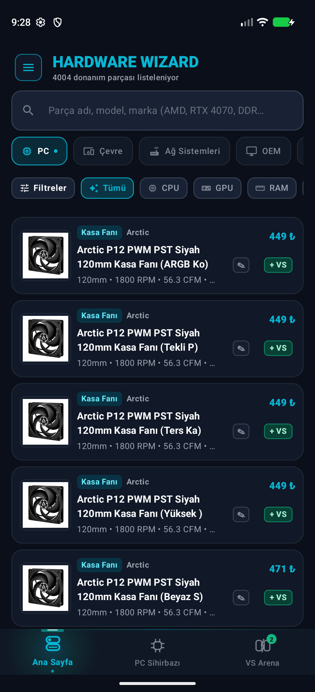 | 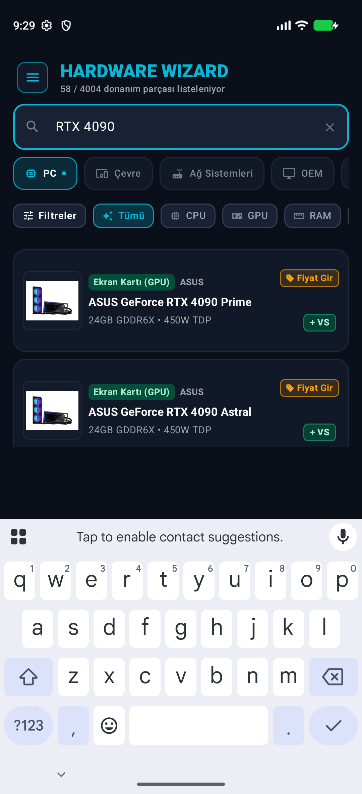 | 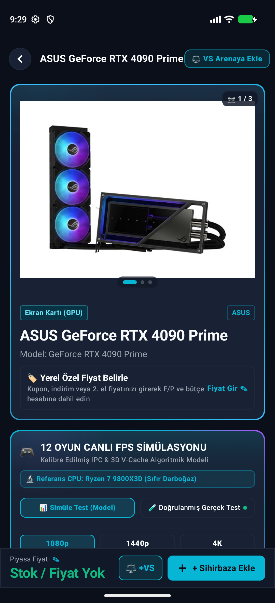 | 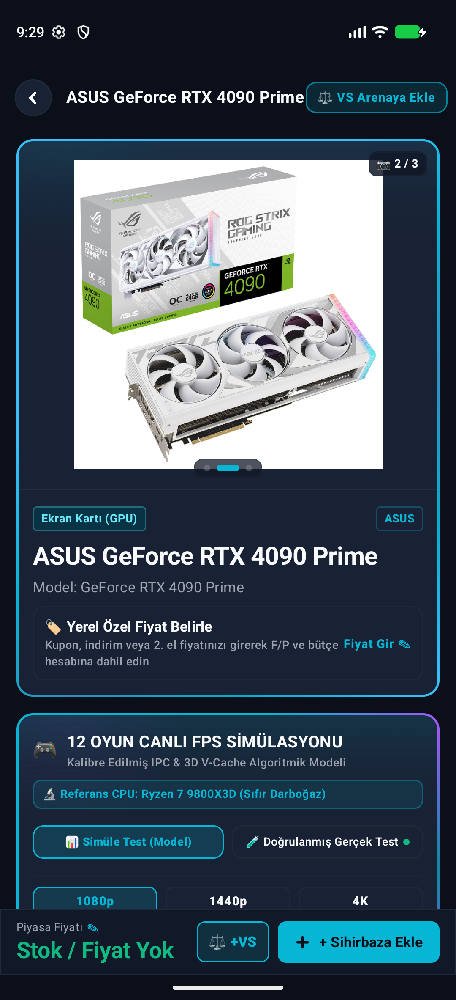 |
| *4.004 Parça, Ekosistem Sekmeleri & Kategori Çipleri* | *RTX 4090 arama sorgusu ve anlık teknik özellik kartları* | *3 Açılı stüdyo fotoğrafçılığı rozeti (`📷 1 / 3`) & Fiyat Analizi* | *Parmak hareketiyle kaydırılabilen açı 2 kutu ve perspektif görünümü* |

<br/>

### ⚡ 2. İnteraktif PC Toplama Sihirbazı & VS Arena Karşılaştırma

| PC Sihirbazı Kokpit HUD & AI Teşhis | VS Arena Kafa Kafaya Kıyaslama |
|:---:|:---:|
| 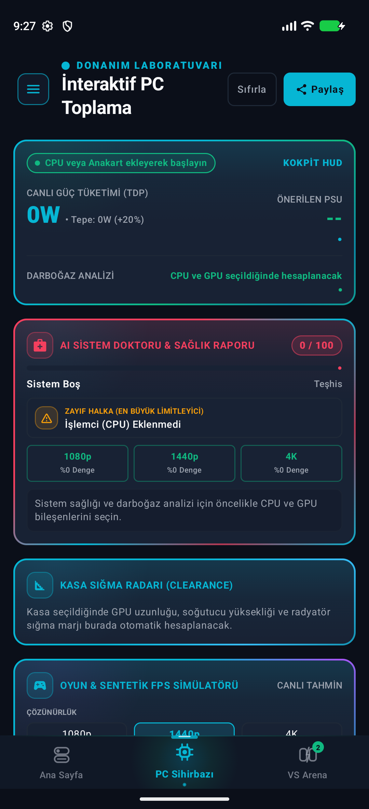 | 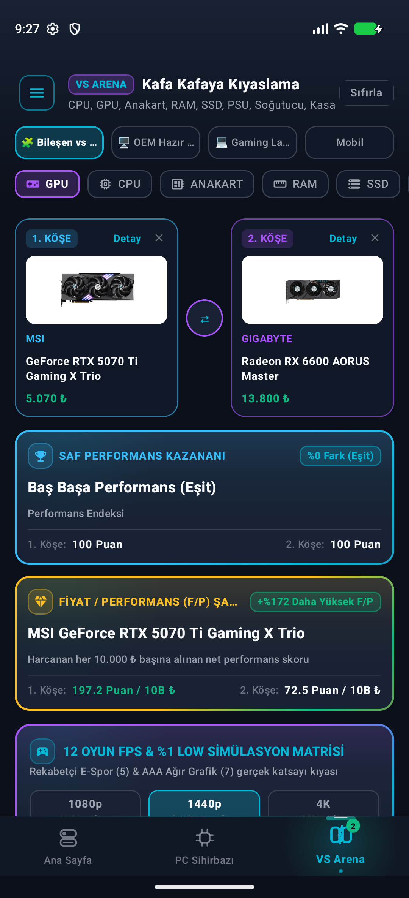 |
| *Canlı TDP hesabı, önerilen PSU, AI Sistem Doktoru (0-100), darboğaz dengesi ve kasa sığma radarı* | *MSI RTX 5070 Ti vs Gigabyte RX 6600, F/P şampiyonu (+%172) ve 12 oyunluk FPS simülasyon matrisi* |

<br/>

### 🔬 3. 11 İnteraktif Mühendislik Laboratuvarı & Termal Simülasyon

| 11 Mühendislik Laboratuvar Menüsü | Thermal Lab (Termal Simülasyon) |
|:---:|:---:|
| 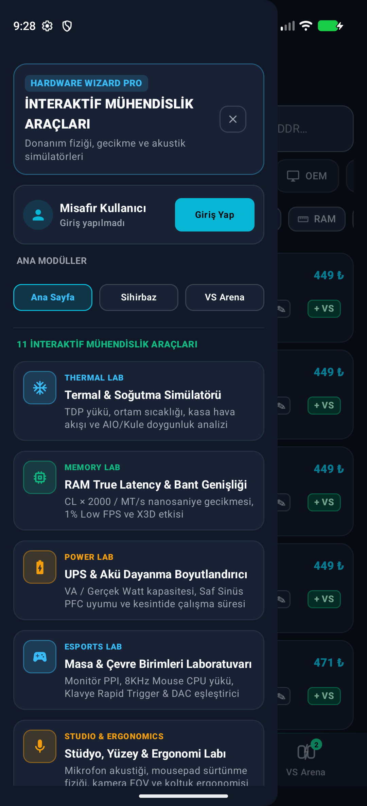 | 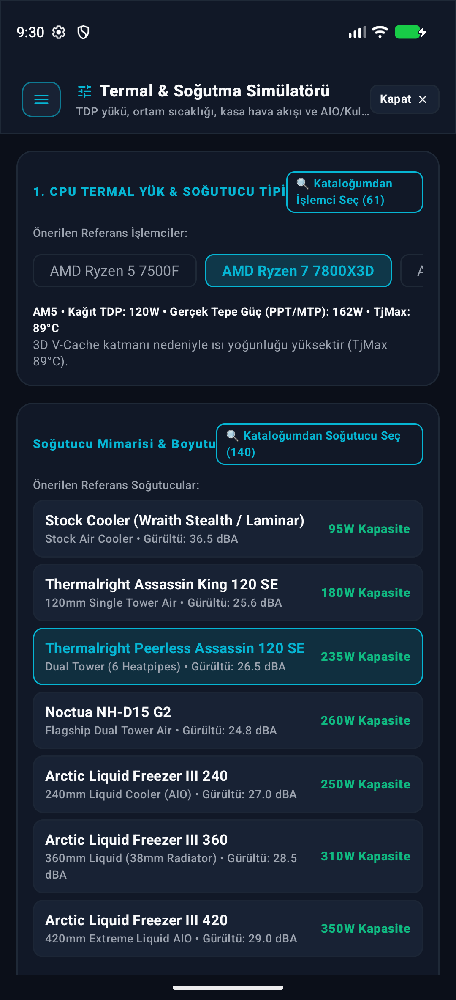 |
| *Thermal Lab, Memory Lab, Power Lab, Esports Latency Lab, Studio & Ergonomics ve 11 aktif araç* | *İşlemci TDP yükü, ortam sıcaklığı, hava akışı ve radyatör ısı yayılım grafikleri* |

<br/>

### 🛡️ 4. Sıfır Güven (Zero-Trust), 2FA Güvenlik & Canlı Moderasyon

| 2FA Güvenlik Konsolu | Canlı Yönetici & Moderasyon Paneli |
|:---:|:---:|
| 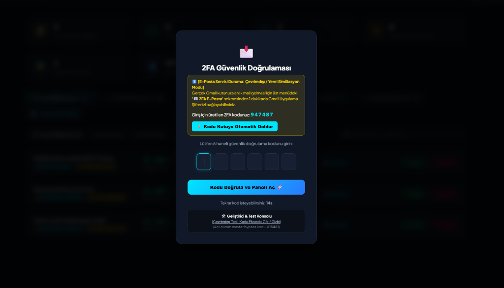 | 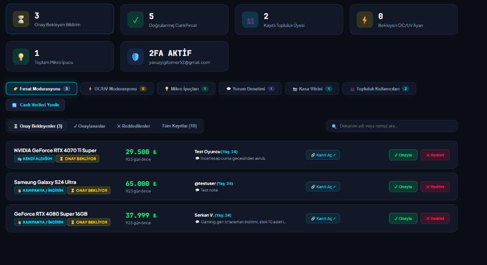 |
| *E-posta kodlu ve OTP destekli 6 haneli zaman aşımı korumalı 2FA konsolu* | *Topluluk donanım fırsatları, OC/UV onayları ve kullanıcı yönetimi* |

</div>

---

## ✨ Öne Çıkan Özellikler

### 1. 🖼️ 3 Açılı Özgün Stüdyo Galerisi (100% Kapsam)
Katalogdaki her bir parça (ekran kartları, güç kaynakları, kasalar, anakartlar, soğutucular, işlemciler, SSD'ler, çevre birimleri) için özel olarak hazırlanmış stüdyo kalitesinde **3 açılı görsel galeri** desteği:
- **Açı 1 (Hero / Ön):** Ürünün vitrin ve tasarım görünümü.
- **Açı 2 (Açı / Perspektif):** Portlar, modüler kablo çıkışları veya fan/radyatör kanatları.
- **Açı 3 (Arka / Detay):** Arka plaka (backplate), soket yapısı veya iç devre mimarisi.
- Detay sayfasında parmak hareketiyle kaydırılabilen (`HorizontalPager`) pürüzsüz animasyonlar.

### 2. ⚡ PC Sihirbazı & Akıllı Uyumluluk Motoru
- **Fiziksel Boyut Uyumluluğu:** Ekran kartı uzunluğu ile kasa maksimum GPU desteği eşleşmesi.
- **Güç & Güvenlik:** İşlemci ve ekran kartı tepe güç tüketimine (TDP) göre önerilen PSU watt gücü ve ATX 3.1 12V-2x6 konnektör denetimi.
- **Soket Doğrulaması:** LGA1851, LGA1700, AM5 ve AM4 için anakart, işlemci ve montaj kiti doğrulaması.
- **RAM Frekans & Yükseklik Analizi:** Çift kanal desteği ve kule tipi soğutucu RAM boşluk denetimi.

### 3. ⚖️ VS Arena (Kafa Kafaya Karşılaştırma)
- İki veya daha fazla donanım bileşenini yan yana getiren interaktif karşılaştırma arenası.
- Sentetik benchmark puanları (Cinebench, 3DMark Time Spy, Geekbench 6, AnTuTu v10).
- Fiyat/Performans indeksi ve gerçek oyun FPS test çıktıları.

---

## 🔬 11 İnteraktif Mühendislik Laboratuvarı & Simülasyon Merkezi

Hardware Wizard, sıradan bir donanım listeleme aracının çok ötesinde; donanım fiziğini, termal dinamikleri, elektrik gücünü ve sinyal gecikmelerini modelleyen **11 profesyonel interaktif mühendislik laboratuvarı** barındırır:

1. ❄️ **Thermal Lab (Termal & Soğutma Simülatörü):** İşlemci TDP yükü, ortam sıcaklığı, kasa içi hava akışı (pozitif/negatif basınç) ve AIO su soğutma ile çift kule hava soğutucuların termal doygunluk eğrilerini simüle eder.
2. ⚡ **Memory Lab (RAM True Latency & Bant Genişliği):** `(CL × 2000) / Hız (MT/s)` formülüyle nanosaniye bazında gerçek gecikmeyi hesaplar; AMD 3D V-Cache etkisi ve %1 Low FPS kazanımını modeller.
3. 🔋 **Power Lab (UPS & Akü Dayanma Boyutlandırıcı):** Sisteminizin prizden çektiği gerçek Watt değerine ve Saf Sinüs PFC uyumuna göre kesintisiz güç kaynağının (UPS) çalışma süresini dakika bazında hesaplar.
4. 🎯 **Esports Lab (Masa & Çevre Birimleri Laboratuvarı):** Monitör PPI piksel yoğunluğu, 8000 Hz Mouse polling rate CPU yükü, Hall Effect Manyetik Switch Rapid Trigger hassasiyeti ve kulaklık DAC empedans eşleştiricisi.
5. 💺 **Studio & Ergonomics Lab (Ergonomi & Akustik Simülatörü):** Oyuncu ve çalışma koltuğu ergonomisi, masa yüksekliği, dinleme açısı ve oda akustiği yankı simülasyonu.
6. 📚 **Knowledge Hub (Mühendislik & Donanım Sözlüğü):** TGP vs TDP farkı, ATX 3.1 12V-2x6 standardı, GDDR6X, QD-OLED ve PCIe 5.0 gibi terimlerin derinlemesine teknik açıklamaları.
7. 📸 **Battlestation Showcase (Topluluk Masaüstü Vitrini):** Kullanıcıların kendi sistemlerini, kablo düzenlerini ve RGB aydınlatma kurulumlarını paylaştığı ilham verici vitrin.
8. 🛡️ **OC / UV Vault (Silikon Kasası):** Kullanıcıların doğrulanmış voltaj ofseti, saat frekansı ve sıcaklık düşüşü sonuçlarını kanıt görseliyle paylaştığı silikon bilgi havuzu.
9. 🔧 **Tuning Lab (Undervolt & Hız Aşırtma Rehberi):** PBO 2, Curve Optimizer ve GPU voltaj-frekans eğrisi optimizasyonları için adım adım etkileşimli kılavuz.
10. 🏷️ **2nd Hand Valuation (İkinci El Değerleme Motoru):** Parça yaşı, garanti durumu, madencilik geçmişi ve kozmetik kondisyona göre ikinci el piyasa değerini ve adil fiyat aralığını tahmin eder.
11. 🛡️ **Moderation & Admin Portal (Güvenlik Konsolu):** Topluluk paylaşımlarını, silikon kasası girdilerini ve 2FA yetkilendirmelerini yöneten canlı idari kontrol paneli.

---

## 📱 Canlı Cihaz Donanım Teşhisi

Mobil uygulama, kullanıcının cihazına kurulduğu anda tek tıkla canlı sistem teşhisi yapar:
* **Yonga Seti & İşlemci:** SoC modelini ve mimarisini tanır.
* **Bellek & Depolama:** Toplam RAM kapasitesi ve anlık boş bellek miktarını gösterir.
* **Ekran Teknolojisi:** 120 Hz / 90 Hz / 60 Hz dinamik yenileme hızını doğrular.
* **Katalog Kıyaslaması:** Cihazınızı piyasadaki 500+ amiral gemisi ve orta segment telefonla kıyaslayarak performans derecesini çıkarır.

---

## 🛡️ Silikon Kasası & Topluluk Gücü

Kullanıcıların kendi donanımlarıyla elde ettikleri optimize edilmiş hız aşırtma (overclock) ve voltaj düşürme (undervolt) ayarlarını paylaştığı doğrulanmış bilgi havuzu:
* **Detaylı Metrikler:** Saat hızı (MHz), Voltaj ofseti / Curve Optimizer (mV), İşlem öncesi ve sonrası sıcaklık (°C).
* **Kanıt Görseli Şartı:** Sonuçların doğrulanabilir olması için ekran görüntüsü veya test kanıtı talep edilir.
* **Moderatör Onay Mekanizması:** Topluluk güvenliği için tüm girdiler admin paneli üzerinden doğrulanır; sahte veya zararlı ayarlar engellenir.
* **Puan & Rozet Sistemi:** Doğrulanan her başarılı ayar kullanıcıya topluluk puanı kazandırır.

---

## 🔐 DevSecOps & Sıfır Güven (Zero-Trust) Güvenlik Mimarisi

Hardware Wizard, hem mobil istemci hem de arka yüz seviyesinde katı siber güvenlik politikalarıyla korunmaktadır:

1. **Sıfır Güven (Zero-Trust) Medya Süzgeci:**
   - Zararlı URL şemaları (`javascript:`, `data:`, `file:`, `blob:`, `http:`) kesin olarak filtrelenir.
   - Sadece onaylı donanım üreticileri ve CDN'ler kabul edilir ([`ALLOWED_IMG_HOSTS`](./scripts/autonomous_hardware_discovery.py)).
2. **Kriptografik Veri Bütünlüğü (SHA-256 Manifestosu):**
   - 20 farklı kategorideki tüm JSON katalog dosyaları SHA-256 hash imzaları ile [`catalog_manifest.json`](./data/catalog/catalog_manifest.json) altında kilitlenmiştir.
   - Uygulama başlatılırken veritabanı manipülasyonu tespit edilirse sistem kendini güvene alır.
3. **2FA Güvenlik Konsolu:**
   - Yönetici ve moderatör panelleri tek kullanımlık 6 haneli zaman aşımı korumalı 2FA kodu ile kilitlenmiştir.
4. **Veritabanı Güvenliği & RLS:**
   - SQL Injection riskini sıfıra indirmek için Room Multiplatform derleme zamanı doğrulamalı ORM kullanılır.
   - Supabase üzerinde **Row Level Security (RLS)** mekanizmasıyla veri erişimi izole edilmiştir.

---

## 🏗️ Yazılım Mimarisi & Teknoloji Yığını

Hardware Wizard, **Temiz Mimari (Clean Architecture)** ve **MVI (Model-View-Intent)** tasarım desenlerine harfiyen bağlı kalınarak geliştirilmiştir.

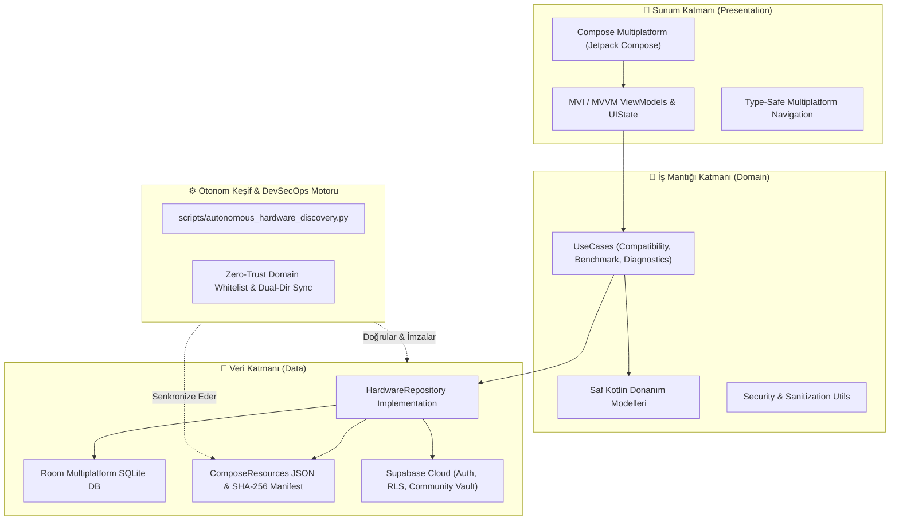

### Teknoloji Yığını
- **Çekirdek:** Kotlin 2.0+ (Kotlin Multiplatform)
- **Kullanıcı Arayüzü:** Compose Multiplatform (Material Design 3, Dark Neon Cyberpunk Teması)
- **Yerel Veritabanı:** AndroidX Room Multiplatform + SQLite Driver
- **Ağ & Arka Yüz:** Ktor Client, Supabase Kotlin SDK (PostgREST, Auth, Realtime, Storage)
- **Görsel Yükleme:** Coil 3 Multiplatform (Asenkron önbellekleme & donanım hızlandırma)
- **Bütünlük & Otomasyon:** Python 3.12+ (DevSecOps donanım keşif motoru, SHA-256 imzalama)

---

## 🚀 Kurulum ve Çalıştırma

### Gereksinimler
- **JDK:** OpenJDK 17 veya üzeri
- **Android Studio:** Ladybug / Meerkat (Kotlin Multiplatform eklentisi ile)
- **Android SDK:** Min SDK 24, Target SDK 34
- **iOS Geliştirme (İsteğe Bağlı):** macOS Sonoma+, Xcode 15+ ve CocoaPods
- **Python:** 3.10+ (Katalog senkronizasyon motoru için)

### Projeyi Klonlama
```bash
git clone https://github.com/omeryavuzyigit61/HardwareWizard.git
cd HardwareWizard
```

### Android Uygulamasını Derleme ve Çalıştırma
```bash
# Debug APK derleme
./gradlew :androidApp:assembleDebug

# Birim ve entegrasyon testlerini koşturma
./gradlew :shared:testAndroidHostTest
```

### Otonom Donanım Keşif & Görsel Senkronizasyon Motorunu Çalıştırma
Piyasaya yeni çıkan donanımları (RX 9070 GRE, RTX 40 Vulcan, Lian Li EDGE vb.) ve 3 açılı görselleri kataloğa işlemek ve SHA-256 manifestosunu yenilemek için:
```bash
python scripts/autonomous_hardware_discovery.py
```

---

## ⚖️ Lisans, Gizlilik ve Yasal Güvence

Hardware Wizard, kaynak kodları, mimari algoritmaları, derlenmiş donanım veritabanı ve tasarımlarıyla birlikte telif hakkı koruması altındadır:

- 📜 **Telif Hakkı ve Lisans:** Bu projenin kaynak kodları, donanım veritabanı ve fikri hakları [LICENSE](./LICENSE) sözleşmesi ile korunmaktadır. İzinsiz kopyalanması, ticari olarak yeniden satılması, veritabanının taranarak (scraping) çalınması veya izin alınmaksızın mağazalarda yayınlanması kesinlikle yasaktır.
- 🔒 **Gizlilik Politikası:** Kullanıcı verilerinin nasıl işlendiği ve KVKK/GDPR uyumluluğu hakkında bilgi almak için [PRIVACY_POLICY.md](./PRIVACY_POLICY.md) belgesini inceleyebilirsiniz.
- ⚖️ **Kullanım Koşulları:** Hız aşırtma/voltaj düşürme feragatnamesi ve topluluk kuralları için [TERMS_OF_SERVICE.md](./TERMS_OF_SERVICE.md) belgesini okuyunuz.
- 🛡️ **Güvenlik Politikası:** Güvenlik açığı bildirim prosedürü ve DevSecOps standartları [SECURITY.md](./SECURITY.md) dosyasında tanımlanmıştır.

---

## 👨‍💻 Geliştirici & İletişim

**Ömer Yavuz Yiğit**  
*Full Stack & Mobile Architecture Engineer*  

- 📧 **E-Posta:** [yavuzyigitomer52@gmail.com](mailto:yavuzyigitomer52@gmail.com)
- 🐙 **GitHub:** [@omeryavuzyigit61](https://github.com/omeryavuzyigit61)
- 🚀 **Proje Deposu:** [HardwareWizard](https://github.com/omeryavuzyigit61/HardwareWizard)

<div align="center">
<sub>Telif Hakkı © 2024 - 2026 Ömer Yavuz Yiğit. Tüm Hakları Saklıdır.</sub>
</div>
